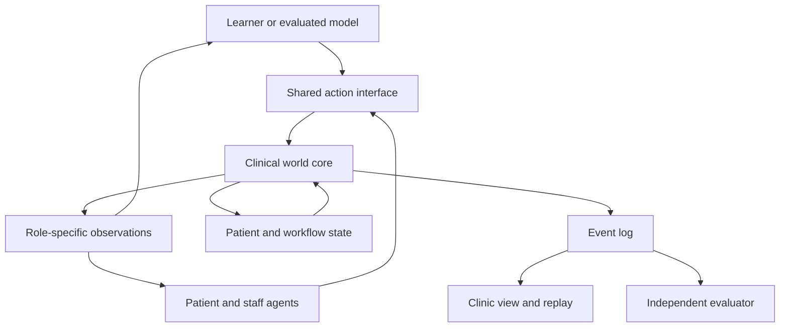

# TCMCraft — Singapore Edition

## Design Proposal for an Interactive, Multimodal and Collaborative Traditional Chinese Medicine Simulation Environment

> This is the project's design proposal, kept as written. What is built so far, and how each part maps onto
> ClinicalCraft today, is in [IMPLEMENTATION.md](IMPLEMENTATION.md); the engine work it still needs is in
> [ENGINE_EXTENSIONS.md](ENGINE_EXTENSIONS.md).

**Proposed setting:** Singapore
**Intended applications:** Professional education, clinical workflow research and AI agent benchmarking
**Technical foundation:** ClinicalCraft, with procedural interaction patterns adapted from SurgeryCraft
**Core acupuncture module:** AcuCraft

## 1. Executive Design Recommendation

TCMCraft should provide a shared clinical environment in which learners and AI agents can complete an entire Traditional Chinese Medicine encounter:

**Patient assessment → four diagnostic examinations → disease diagnosis and pattern differentiation → treatment planning → treatment execution → follow-up and revision.**

The environment should make each step observable and verifiable. A patient should be able to move through the clinic, communicate with different practitioners, undergo appropriate examinations, receive a reviewed treatment plan and return for follow-up. Staff should coordinate through a shared patient record, while medicines, instruments and treatment devices should have explicit states and permitted actions.

The recommended implementation is:

> **A Singapore-focused TCM content pack running on the ClinicalCraft engine, with shared engine extensions for prescription management, procedural treatment and longitudinal care.**

The repository documentation reviewed describes SurgeryCraft as a ClinicalCraft content pack loaded through `contentDirs`. ClinicalCraft already separates its simulation core, spatial world, agent runtime and benchmarking components. These documented interfaces provide a suitable architectural starting point; compatibility and runtime behaviour should be verified during implementation. [SurgeryCraft README](https://github.com/psknlr/SurgeryCraft/blob/main/README.md) · [ClinicalCraft Architecture](https://github.com/psknlr/ClinicalCraft/blob/main/docs/ARCHITECTURE.md)

### Relationship between the three projects

| Project | Main clinical activities | Principal capabilities assessed |
|---|---|---|
| **ClinicalCraft** | Consultation, examination, investigations, treatment, referral and handover | Information gathering, clinical decisions, tool use and coordination |
| **SurgeryCraft** | Perioperative care, instrument handling, operative procedures and complication management | Spatial reasoning, procedural execution, anatomical recognition and teamwork |
| **TCMCraft** | Four examinations, pattern differentiation, herbal prescribing, acupuncture, tuina and follow-up | Multimodal evidence integration, contextual treatment decisions, execution and longitudinal adaptation |

The central research question should be:

> **Can an AI agent acquire relevant clinical evidence, maintain defensible diagnostic and pattern hypotheses, coordinate appropriate treatment, and revise its decisions as new information becomes available?**

---

## 2. Singapore Context and Localisation

Singapore should shape the clinical roles, terminology, communication tasks, medicine catalogue and referral workflows represented in the environment.

### 2.1 Proposed clinical setting

The initial environment should be a **fictional Singapore outpatient TCM centre**, with configurable access to external medical services.

| Design element | Proposed Singapore implementation |
|---|---|
| Clinical setting | Community TCM clinic, treatment rooms and herbal dispensary |
| Communication | English and Mandarin initially, with validated additional language support where required |
| Patient information | Preferred language, interpretation needs, existing medical care and current medicines |
| Care coordination | Simulated referral and handover to appropriate medical services |
| Time and costs | Singapore time and SGD-denominated scenario costs |
| Professional roles | Permissions mapped to the practitioner's qualifications, permitted practice and institutional responsibilities |
| Environmental context | Singapore weather, living conditions and individual exposures where relevant to a case |

The system should distinguish registered **TCM physicians** and **acupuncturists**. Singapore requires practitioners to be registered with the Traditional Chinese Medicine Practitioners Board and to hold a valid Practising Certificate to practise. The corresponding simulated roles should therefore have separate capability profiles. [Traditional Chinese Medicine Practitioners Board](https://www.tcmpb.gov.sg/for-professionals/registered-tcm-practitioners/application-for-practising-certificate/)

Herbal dispensary staff, clinic assistants and tuina workflow roles should be represented as functional roles with explicitly assigned responsibilities. Their job labels should not automatically grant prescribing or procedural authority.

### 2.2 Communication and professional practice

The Singapore assessment framework should include:

- Explaining the proposed treatment and available alternatives.
- Discussing relevant benefits, risks and possible complications.
- Recording consent and the patient's preferences.
- Maintaining accurate consultation and treatment records.
- Recognising when additional expertise is required.
- Completing a meaningful referral and handover.

These dimensions can be developed with reference to the TCMPB Ethical Code and Ethical Guidelines, which address assessment, consent, confidentiality, records and referral. [isomer-user-content.by.gov.sg](https://isomer-user-content.by.gov.sg/80/0a3d0633-3264-4012-91f8-f39375fa41ec/ethical-code-and-ethical-guidelines-for-tcmp-%28eng%29.pdf)

### 2.3 Local environmental context

Singapore has a tropical climate with high humidity, abundant rainfall and monsoon-related variation. Seasonal-health scenarios should therefore use locally relevant environmental information. [Weather Information Portal](https://www.weather.gov.sg/climate-climate-of-singapore/)

For the simulator, weather and environmental exposure should be contextual variables. Any proposed relationship between those variables and clinical decisions should be evaluated explicitly.

---

## 3. Research Positioning and Intended Contributions

Interactive TCM evaluation already has relevant precedents.

| Existing work | Relevant coverage | Implication for TCMCraft |
|---|---|---|
| **ATCMD-Bench** | Multi-agent TCM diagnosis, patient interaction and access to four-examination findings | Interactive TCM consultation is an established research direction. [www.sciencedirect.com](https://www.sciencedirect.com/science/article/abs/pii/S0031320326006448) |
| **DCB** | Inquiry, pattern differentiation, prescription and analysis tasks based on 205 cases, including misleading information | The contribution should extend to verifiable execution and environmental interaction. [www.sciencedirect.com](https://www.sciencedirect.com/science/article/pii/S0957417426011802) |
| **TCM-MisDx, preprint** | Interactive reassessment and correction after treatment failure | Follow-up reasoning should incorporate actual execution records and distinct causes of failure. [arxiv.org](https://arxiv.org/abs/2610.40663) |

A detailed comparison should examine each system's implementation before claiming a particular capability is absent.

TCMCraft should concentrate on four contributions.

### Contribution 1: Verifiable clinical execution

Every consequential action should produce a traceable state transition.

A prescription can be drafted, reviewed, revised, dispensed and used. Each stage should be recorded separately, allowing the evaluator to establish what actually happened.

### Contribution 2: Active acquisition of multimodal evidence

The agent should decide which question, examination or observation to obtain next.

Evidence should carry information about its source, timing and quality. An agent may need to repeat an examination, request a clearer image or reconcile conflicting reports.

### Contribution 3: Evaluation of multiple defensible pathways

Expert-reviewed cases should permit different justified interpretations and treatment approaches.

Each acceptable pathway must satisfy the patient's evidence, relevant constraints and required clinical actions.

### Contribution 4: Longitudinal reasoning grounded in execution history

Follow-up should require the agent to distinguish among:

- An initial assessment that needs revision.
- A treatment plan that was not implemented as intended.
- Incomplete adherence.
- A change in the patient's condition.
- An adverse event.
- Effects associated with concurrent treatment or other circumstances.

Together, these contributions support evaluation of clinical performance across an encounter.

---

## 4. Shared System Architecture

### 4.1 A common simulation core

TCMCraft should use the same action and event infrastructure for human learners, evaluated models and supporting agents.

ClinicalCraft's protocol documentation describes a shared session interface across front ends. SurgeryCraft's interaction documentation describes people and objects acting through a common world model with permissions, prerequisites, reach and duration. These are useful patterns to retain. [ClinicalCraft Protocol](https://github.com/psknlr/ClinicalCraft/blob/main/docs/PROTOCOL.md) · [SurgeryCraft Interactions](https://github.com/psknlr/SurgeryCraft/blob/main/docs/INTERACTIONS.md)

### 4.2 Separate facts, interpretations and execution

The patient model should contain five distinct layers.

| Layer | Contents | Purpose |
|---|---|---|
| **Underlying case facts** | History, symptom development, background conditions and authored clinical events | Maintain case consistency |
| **Acquired evidence** | Disclosed answers, images, examination findings, reports and measurements | Establish what each participant actually knows |
| **Clinical interpretations** | Disease hypotheses, TCM patterns, supporting evidence and uncertainty | Allow justified reasoning and revision |
| **Execution state** | Orders, prescription versions, reviews, dispensing, procedures and handovers | Verify implementation |
| **Longitudinal state** | Follow-up findings, adherence, functional change and adverse events | Support continuing care |

The following information states must remain distinct:

**Not asked; not examined; uncertain; not recorded; explicitly absent.**

For example, a symptom that the patient has not mentioned should remain unknown until it is elicited or otherwise documented.

Pattern assessments should retain their theoretical framework, supporting observations and degree of certainty. Expert disagreement can then be recorded without changing the underlying clinical facts.

### 4.3 Explicit action contracts

Each action should specify:

**Actor, patient, location, target, prerequisites, parameters, duration, state changes and event identifier.**

| Action | Example prerequisites | Resulting state change |
|---|---|---|
| Capture a tongue image | Patient participation and suitable acquisition conditions | New image with timestamp and quality metadata |
| Perform a simulated pulse examination | Appropriate examination conditions | Release of the relevant examination record |
| Submit a prescription | Complete patient and medicine information | New prescription version awaiting review |
| Dispense medicines | Valid prescription and matching stock | Inventory transaction and dispensing record |
| Perform an acupuncture step | Correct patient, site, equipment and preparation | Updated procedural and needle state |
| Arrange follow-up | Defined timing and clinical objectives | Scheduled follow-up episode |

Version checks should prevent an outdated prescription from being executed. Repeated tool requests should not duplicate dispensing or procedural actions.

A simulation clock should coordinate examination time, preparation, treatment and follow-up intervals. Model response latency should be recorded separately from simulated clinical time.

### 4.4 Missing investigations and generated reports

The environment should support supplementary reports through a controlled authoring process:

1. Use available authorised clinical records.
2. Identify information required by the intended scenario.
3. Develop missing material through expert authoring or constrained generation.
4. Label generated material and document its basis.
5. Review and freeze the material within a specific case version.

A report-generation agent may organise approved facts into readable text. During formal evaluation, its output should remain consistent with the fixed case state.

Unsupported investigations should return a defined unavailable or unmodelled status.

---

## 5. Six Core Clinical Modules

### 5.1 Four Examinations and Pattern Differentiation

This module should be the primary entry point.

| Diagnostic channel | Interactive activities | Capabilities assessed |
|---|---|---|
| **Inspection** | Examine tongue images, posture, gait and relevant visible findings; request repeat acquisition | Visual interpretation and quality assessment |
| **Listening and smelling** | Listen to speech, breathing or cough recordings; access documented odour observations | Audio interpretation and source awareness |
| **Inquiry** | Interview the patient or companion and reconcile previous history | Question selection, clarification and information prioritisation |
| **Palpation** | Request simulated pulse, tenderness, local palpation and movement findings | Examination selection and interpretation |

Consultations should use **one or two brief questions per turn**, with subsequent questions selected according to the answer.

Every observation should identify its source. A clinician-authored pulse description, a measured waveform and an agent's interpretation should remain separate records.

The structured assessment should include:

- Disease diagnosis and relevant differentials.
- Current TCM pattern hypothesis.
- The differentiation framework used.
- Supporting and conflicting observations.
- Remaining uncertainty.
- Additional information that could change management.
- Proposed treatment principles.

Terminology mapping can use WHO's international standard terminology for TCM as a reference for consistent concepts and translations. [www.who.int](https://www.who.int/publications/i/item/9789240042322)

A useful challenge is to provide an unclear tongue photograph or an old examination record and test whether the agent recognises the limitation, obtains better evidence and updates its assessment appropriately.

### 5.2 Herbal Prescribing and Dispensing

This module should model the full prescribing workflow:

**Treatment principle → prescription draft → review → revision or confirmation → preparation and dispensing → patient instructions → recorded use.**

The prescription record should contain:

- Standardised medicine names and relevant synonyms.
- Medicinal material identity, part used and processing form.
- Product or preparation type.
- Dose, unit, route, frequency and duration.
- Preparation instructions.
- Prescriber and prescription version.
- Review comments and their resolution.
- Dispensing and counselling records.

The dispensary should maintain stock, batch, expiry and preparation information. A mismatch between the prescribed item and available stock should generate a review task.

#### Singapore product classification

The catalogue should distinguish **Chinese proprietary medicines (CPM)** from **traditional medicinal materials (TMM)**.

HSA describes CPM as finished medicinal products and specifies applicable product-listing and dealer-licensing requirements. TMM have a different regulatory treatment, with dealers responsible for their safety and quality. [Health Sciences Authority](https://www.hsa.gov.sg/chinese-proprietary-medicines/overview/)

The simulator should therefore maintain product-specific classification and verification fields. Prepared decoctions, granules and extracts should be classified according to the actual product and preparation.

#### Meaningful review tasks

The medicines-review function should be able to identify:

- An incomplete medication history.
- Ambiguous medicine identity.
- Inconsistent units or preparation instructions.
- A relevant interaction concern.
- A product mismatch.
- A discrepancy between the current prescription and the supplied medicines.

The responsible reviewer should be assigned according to the scenario's professional roles.

Each safety rule should retain its source, applicability and certainty. WHO's technical work on herb–drug interactions can inform the structure of this evidence layer. [www.who.int](https://www.who.int/publications/i/item/9789240019140)

The assessment should follow the entire resolution: identifying the issue, obtaining missing information, revising the order and ensuring that the correct version is supplied.

### 5.3 AcuCraft: Acupuncture Decision-Making and Procedures

AcuCraft should adapt SurgeryCraft's instrument lifecycle, anatomical representation, procedural prerequisites and event replay.

Development should proceed through three levels.

#### Level 1: Clinical planning

Assess whether the agent can consider:

- The patient's current condition and treatment goals.
- Disease and pattern assessments.
- Relevant local findings.
- Patient preferences and previous treatment.
- Point-selection rationale.
- Whether treatment should proceed, be modified or be deferred.

Different theoretical approaches can be represented when experts specify their supporting evidence and conditions of use.

#### Level 2: Visible procedural workflow

Represent the procedure as discrete actions:

**Suitability assessment, explanation and consent, positioning, site confirmation, equipment preparation, simulated treatment, observation, response to unexpected symptoms, completion and documentation.**

The interface should display:

- Patient position.
- Current treatment region.
- Planned and completed steps.
- Instrument and needle status.
- Patient feedback.
- Outstanding checks.
- Interruptions and changes to the plan.

The displayed procedure should follow committed simulation events.

#### Level 3: Local three-dimensional anatomy

For the initial cases, develop the specific body regions needed for the intended tasks.

Represent anatomical landmarks, tissue layers and relevant structures. Point locations should remain linked to the patient's anatomy when posture or camera position changes.

The screen-based version should evaluate planning, localisation, procedural sequence and response to events. Assessment of tactile skill requires appropriate hardware and separate validation.

WHO's acupuncture practice benchmarks provide a reference for procedural organisation, infrastructure and safe practice. Singapore-specific rules should be authored using the relevant TCMPB guidance. [www.who.int](https://www.who.int/publications/i/item/978-92-4-001688-0)

Moxibustion and electroacupuncture can be added later, each with its own device states, operating conditions and assessment criteria.

### 5.4 Tuina and Rehabilitation

The initial tuina module should focus on assessment, planning, patient feedback and verifiable workflow.

Actions should include:

- Assessing suitability.
- Reviewing relevant examination findings.
- Choosing patient position and treatment region.
- Selecting a simulated technique.
- Defining duration and permitted operating parameters.
- Monitoring feedback.
- Adjusting, pausing or terminating treatment.
- Documenting function and follow-up objectives.

Some scenarios should require further evaluation before treatment proceeds.

Later hardware integration may add measurable contact position, force, rhythm and posture. WHO's tuina practice benchmarks can inform the procedural framework. [www.who.int](https://www.who.int/publications/i/item/9789240016903)

### 5.5 Coordination between TCM and Conventional Medical Care

Each case should retain both:

1. Disease-related findings and clinical risks.
2. TCM pattern assessments and treatment interpretations.

The agent should determine when to continue the current consultation, obtain additional information, seek another opinion, modify treatment or initiate referral.

For the Singapore edition, investigation ordering and conventional medical prescribing should be assigned to roles with the appropriate authority in the represented service arrangement. A community-clinic scenario may require a referral or an external service request.

Handover should transmit the relevant findings, current medicines, treatment already delivered, concerns and outstanding actions.

### 5.6 Longitudinal Follow-Up and Preventive Care

Follow-up should be part of the case structure from the beginning.

A patient may have an initial consultation, an early review, a reassessment after a treatment change and a later follow-up.

The agent should review:

- Symptoms and functional status.
- What treatment was actually received.
- Adherence and practical barriers.
- New findings or concurrent care.
- Possible adverse events.
- Whether the original interpretation remains defensible.

Later extensions may include dietary advice, activity, sleep, emotional wellbeing and constitution-related assessments. Seasonal or Five Movements and Six Qi components can be evaluated as optional research modules using locally relevant context.

#### Interpreting simulated outcomes

| Source of follow-up information | Appropriate use | Interpretation |
|---|---|---|
| Recorded clinical follow-up | Evaluate reasoning about observed patient trajectories | Performance on the available records |
| Expert-authored branches | Teach adaptation and responses to specific events | Behaviour under the specified scenario |
| Calibrated outcome model | Explore simulated changes within validated conditions | Results conditional on the model and its assumptions |

**Process completion, expert agreement and simulated outcomes should be reported separately. Clinical effectiveness requires independent clinical evidence.**

---

## 6. Autonomous Roles and Environmental Interaction

The first version should support a small, purposeful team.

| Role | Autonomous responsibilities | Main interactions |
|---|---|---|
| **Patient** | Respond, move when able, participate, report symptoms and treatment use | Practitioner, assistant, dispensary and treatment staff |
| **TCM physician** | Assess, differentiate patterns, plan treatment and review progress | Patient, reviewer, treatment practitioner and referral service |
| **Acupuncture practitioner** | Verify the plan, complete authorised procedural steps and respond to feedback | Patient, physician and assistant |
| **Clinic assistant or nurse** | Perform assigned preparation, observations, guidance and handover | Patient and clinical team |
| **Dispensary or medicines-review role** | Check assigned information, resolve discrepancies and document supply | Prescriber and patient |
| **Consulting or referral clinician** | Address a defined clinical question and support care transitions | Referring practitioner and patient |

Every role should have its own information access, responsibilities, task queue, location, carried objects and outstanding commitments.

For example, while the physician reviews a report, an assistant can prepare the treatment area and the dispensary can check the prescription. A discrepancy should create a new task for the physician.

Movement should reflect patient mobility and available support. Walking, guided movement, assisted transfer and bedside assessment can all be represented.

The first clinic layout can include:

**Waiting area, consultation room, examination station, treatment room, dispensary, medicine collection area and follow-up interface.**

Routine movement and object handling should use deterministic behaviour rules. Language-model calls should be triggered by relevant events or decisions.

---

## 7. Example Singapore Clinical Episode

### Scenario: Recurrent Low Back Pain

A patient attends a fictional Singapore TCM clinic with recurrent low back pain, previous medical records and a history of concurrent medicine use.

Initially, only the presenting complaint and limited background are available.

| Stage | Agent task | Required environmental response |
|---|---|---|
| Initial consultation | Clarify symptoms, chronology and relevant associated features | Disclose information according to the questions asked |
| Examination | Select appropriate four-examination and physical findings | Release the corresponding records or media |
| Assessment | Form disease and pattern hypotheses | Save interpretations and evidence references |
| Planning | Propose an appropriate management pathway | Create structured orders or referral tasks |
| Review | Resolve a medicine or preparation discrepancy | Record the issue and the revised prescription |
| Treatment | Coordinate and complete authorised procedural actions | Update patient, instrument and workflow states |
| Follow-up | Review change, adherence and actual execution | Present the predefined follow-up evidence |
| Revision | Maintain, modify or escalate the plan | Create a traceable subsequent decision |

Three useful variants are:

**Evidence-quality variant.** A tongue image is unclear or an examination record is outdated. The agent should decide whether better information is needed.

**Escalation variant.** New clinical findings meet an expert-authored criterion for urgent assessment. Successful performance requires an appropriate care transition and handover.

**Non-improvement variant.** The patient reports little improvement. The scenario distinguishes incomplete adherence, an execution problem, a changed condition and an assessment requiring revision.

Variants derived from one base case should remain within the same data partition and statistical case family.

---

## 8. Benchmark and Evaluation Design

### 8.1 Primary endpoint

The recommended primary endpoint is **safe task completion**:

> Completion of the case's required clinical objectives without a predefined critical error.

Critical errors should also be reported separately.

| Dimension | Main assessment question |
|---|---|
| Information acquisition | Were the facts that could change management obtained? |
| Evidence interpretation | Were quality, timing and contradictions handled appropriately? |
| Disease and pattern assessment | Was the interpretation supported by the acquired evidence? |
| Treatment coherence | Did the plan fit the patient, evidence and stated principles? |
| Execution | Were the required actions actually completed? |
| Collaboration | Were requests, objections, revisions and handovers resolved? |
| Follow-up adaptation | Was the plan updated appropriately after new information? |
| Resource use | Were time, investigations and model resources used reasonably? |

An unsafe order intercepted by another agent should generate separate records for the original error, the interception, the response and the final team outcome.

### 8.2 Multiple acceptable solutions

Each case should define:

- Acceptable interpretations and their supporting evidence.
- Treatment principles and plans considered defensible.
- Required information and actions.
- Conditions that change the preferred pathway.
- Unacceptable decisions or actions.
- Areas of expert disagreement.

State-based events should be checked programmatically. Clinical interpretations should be reviewed by experts blinded to model identity. An LLM judge can assist with organising evidence and preliminary review.

Brief decision rationales should reference the evidence actually available at the time.

### 8.3 Four core experiments

| Scientific question | Comparison | Main outcomes |
|---|---|---|
| **Does the patient simulator affect evaluation reliability?** | Free generation, language generation constrained by frozen facts and deterministic responses | Contradictions, fabricated facts, answer leakage and ranking stability |
| **Does teamwork help beyond additional computation?** | Single agent, single agent with self-review, homogeneous team and heterogeneous team | Safe completion, critical errors, cost and latency |
| **Does evaluation with multiple acceptable solutions better reflect expert assessment?** | Single-label matching versus expert-defined evidence-constrained solution sets | Rejection of acceptable plans, acceptance of unsafe plans and agreement with experts |
| **Can agents identify why a patient has not improved?** | Full execution history, summarised history and limited history | Appropriate clarification, failure attribution and treatment revision |

Additional ablations should examine:

- Original images or audio versus expert textual descriptions.
- No retrieval, classical-text retrieval, contemporary evidence retrieval and combined retrieval.
- Presence or absence of a medicines-review role.
- Different language presentations of the same clinical facts.

All team members and coordination costs should be included in resource accounting. Where hidden reasoning usage cannot be measured, report the observable usage, financial cost and latency.

Environment versions and evaluated policies should remain fixed during the principal benchmark. Reset case-specific memory between independent test cases.

---

## 9. Data, Validation and Singapore Governance

### 9.1 Case construction

Each case should contain:

- Initial presentation and disclosure rules.
- Available examination findings and multimedia.
- Permitted actions and required prerequisites.
- Orders and procedural state definitions.
- Follow-up events.
- Accepted interpretations and scoring rules.
- Provenance, permissions, review status and version information.

Classical literature can support terminology and theoretical reasoning. Executable cases additionally need clear patient conditions, timelines, observations and operational objectives.

### 9.2 Proposed dataset scale

The following are planning figures:

| Stage | Suggested scale | Purpose |
|---|---:|---|
| Initial prototype | **12 independent cases** | Verify complete encounters and scoring |
| Engineering pilot | **Approximately 60 independent cases** | Test workflow diversity and reliability |
| Formal benchmark | **Initially plan around 240 independent cases** | Support model comparisons, subject to pilot-based sample-size revision |

The first complete pathway should focus on musculoskeletal pain. Insomnia and gastrointestinal presentations can then test whether the framework generalises across clinical tasks.

Split data by patient, source and case template. Keep paraphrases, variants and follow-up episodes from the same underlying case together.

Formal evaluation should use paired comparisons and confidence intervals that account for repeated runs within each independent case.

### 9.3 Data governance

Begin development with synthetic cases or appropriately de-identified material, with permissions and residual identification risk documented.

Where real patient information is used, record the permitted purpose, applicable consent or exception, access controls and institutional authorisation. Singapore's PDPC healthcare guidance addresses purpose notification, consent and applicable exceptions; permission for treatment should not be assumed to cover every secondary research or model-development use. [pdpc.gov.sg](https://www.pdpc.gov.sg/-/media/files/pdpc/pdf-files/advisory-guidelines/advisory-guidelines-for-the-healthcare-sector-sep-2023.pdf)

In sealed evaluation, hidden case facts, future outcomes and scoring rubrics should remain inaccessible to the evaluated agents.

### 9.4 Validation priorities

Validation should establish:

- Clinical plausibility of the cases.
- Consistency of patient responses.
- Correctness of state transitions.
- Equivalence between visual and headless execution.
- Agreement between automated scoring and expert review.
- Sensitivity to meaningful errors.
- Robustness across patient-language formulations and simulator implementations.

For educational research, an additional study could assess transfer to an independently designed examination or standardised-patient encounter.

---

## 10. Implementation Roadmap

### Phase 1: Complete a single longitudinal encounter

Deliver one case covering consultation, four examinations, assessment, prescription review, treatment and follow-up.

**Acceptance criterion:** Every meaningful action is reflected correctly in the event log and final state.

### Phase 2: Build the 12-case prototype

Add uncertain evidence, review disagreements, execution discrepancies and alternative follow-up branches.

**Acceptance criterion:** Each case has reviewed rules, reference trajectories and defined failure conditions.

### Phase 3: Expand to the 60-case engineering pilot

Add autonomous supporting roles, relevant local anatomy, visible procedures and headless evaluation.

**Acceptance criterion:** Human and AI interfaces use the same clinical logic, and episodes can be replayed reliably.

### Phase 4: Conduct the formal benchmark

Freeze the environment, establish an independent test set, run the model comparisons and obtain blinded expert ratings.

**Acceptance criterion:** The study can answer its predefined scientific questions with reproducible evidence.

### Phase 5: Extend specialised capabilities

Add validated pulse hardware, tuina interfaces, moxibustion, electroacupuncture and preventive-care modules as separate capabilities.

### Recommended code organisation

| Component | Proposed additions |
|---|---|
| `content/cases` | TCM cases, longitudinal episodes and scenario branches |
| `content/facilities` and `templates` | Singapore clinic, treatment rooms and dispensary |
| `content/catalogs` and `assets` | Medicines, instruments, equipment and visual assets |
| ClinicalCraft `core` | General prescription, execution, follow-up and consistency mechanisms |
| ClinicalCraft `world` | New object behaviours and procedural interactions |
| ClinicalCraft `agent` | TCM role profiles, evidence access and model/tool integration |
| ClinicalCraft `bench` | TCM task suites, scoring, auditing and reporting |

TCM-specific knowledge and assets should remain in the content pack. General mechanisms useful to multiple clinical domains should extend the shared engine.

---

## 11. Integration with TaoChronos and TCMScience

The projects can have complementary responsibilities.

| Project | Proposed responsibility |
|---|---|
| **TaoChronos** | TCM decision-making model and teaching demonstrator |
| **TCMScience** | Evidence retrieval and research tools with traceable sources |
| **TCMCraft** | Patients, staff, objects, clinical actions and longitudinal state |
| **AcuCraft** | Acupuncture planning and procedural tasks |
| **Independent evaluator** | Verification of execution, clinical acceptability and generalisation |

This supports a controlled development cycle:

**The model proposes decisions → the environment executes permitted actions → the evaluator identifies failures → development changes are made → performance is reassessed on independent cases.**

Research outputs from TCMScience should retain their evidence type and applicability when used in clinical tasks.

### Suggested manuscript title

> **TCMCraft: An Interactive Environment for Longitudinal and Collaborative Clinical Decision-Making in Traditional Chinese Medicine**

### Singapore-specific project subtitle

> **A Singapore-Focused Framework for Multimodal Assessment, Herbal Medicine Workflows, Acupuncture Simulation and Clinical AI Evaluation**

**The recommended first deliverable is one complete Singapore outpatient episode in which a patient undergoes assessment, a justified treatment plan is reviewed and executed, and follow-up leads to an evidence-based decision.** Establishing that pathway will provide a concrete foundation for expanding the case library, adding treatment modules and measuring the value of each new capability.
